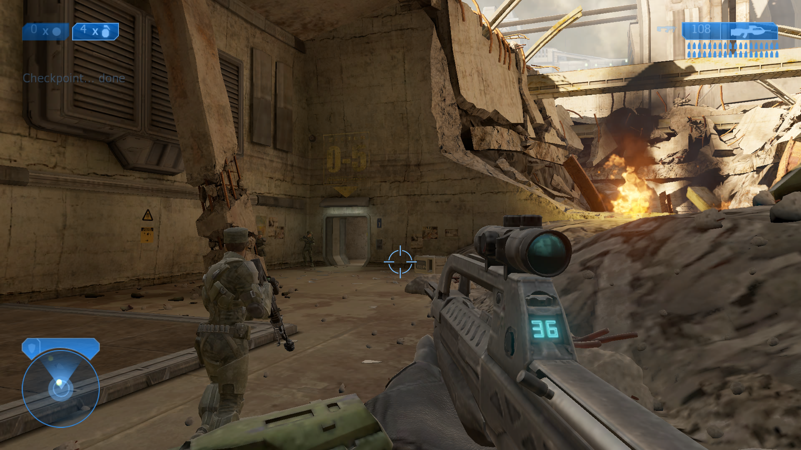

# Installation 08

**Halo: The Master Chief Collection, offline.** A small launcher that runs MCC's games on their own, without MCC's launcher, Steam or Easy Anti-Cheat, on a Windows PC or on a jailbroken PS5 through [prospero-win](https://github.com/mpereiraesaa/prospero-win).

Installation 08 includes no game files. You need your own copy of Halo: The Master Chief Collection on Steam.

<p align="center">
   
</p>

## Download

Get the latest from [Releases](../../releases):

|File|For|
|-|-|
|`Installation08-<version>.zip`|Windows PC: `installation08.exe` and its README|
|`Installation08-PS5.zip`|PS5 with prospero-win: everything except your game files|

## What it does

|||
|-|-|
|**Campaign**|Halo CE, Halo 2, Halo 3, ODST, Reach and Halo 4. Continue from your last save, or pick any mission and difficulty. Anniversary or classic graphics in Halo CE and Halo 2|
|**Firefight**|Reach and ODST, with every game type MCC ships|
|**Spartan Ops**|All 50 Halo 4 missions|
|**Custom games**|Halo CE, Halo 2, Halo 3, Reach and Halo 4: every map, the stock and matchmaking game types, and your own|
|**Forge**|Halo 3, Reach and Halo 4|
|**Split-screen**|Up to 4 players in all of the above|
|**Controls**|Per-game controller and keyboard/mouse remapping, PlayStation or Xbox button names|

Everything is local. There is no online play.

## Setup on a PC

1. Copy `installation08.exe` into your MCC folder, next to `halo1`, `halo2`, `halo3` … For Steam that is usually `C:\\Program Files (x86)\\Steam\\steamapps\\common\\Halo The Master Chief Collection`.
2. Run it.

Windows Defender may be wary of a new, unsigned program that loads game files; if it flags it, add an exclusion. More in the [PC README](dist/README.txt).

## Setup on a PS5

You need a jailbroken PS5 with [prospero-win](https://github.com/mpereiraesaa/prospero-win) working, an FTP server on the console, and [FileZilla](https://filezilla-project.org) on your PC. No PC tools to build or install.

1. Copy the `prospero-win` folder from `Installation08-PS5.zip` into `/data/` on the PS5.
2. Copy your MCC game folders (and `mcc/binaries/win64`) into `/data/prospero-win/mcc/`.
3. Start prospero-win and choose Installation 08.

Step-by-step instructions, with every click, are in [README-PS5.txt](ps5/README-PS5.txt).

## Known limits

* Halo 4's custom loadouts aren't set up, so Spartan Ops and loadout game types start with DMR and DMR.
* In-game button prompts are the games' own (Xbox).
* On the PS5: two controllers at once for split-screen is untested
* Random crashes are to be expected

## Building

One C++ source file, built with MinGW-w64 (Linux or WSL: `sudo apt-get install g++-mingw-w64-x86-64`):

```sh
cd src
x86\_64-w64-mingw32-windres installation08.rc -O coff -o res.o
x86\_64-w64-mingw32-g++ -std=c++17 -O2 -municode -static -s -Wall -Wno-unused-parameter \\
    -o installation08.exe installation08.cpp res.o \\
    -ld3d11 -ldxgi -lgdi32 -ld2d1 -ldwrite -ladvapi32
```

Every push is also built by GitHub Actions; the exe is attached to each run.

The PS5 package is made from a prospero-win recipe; see [MAKING-THE-PS5-PACKAGE.txt](ps5/MAKING-THE-PS5-PACKAGE.txt).

## Repository

|Folder|What's in it|
|-|-|
|`src/`|The launcher's source and version resource|
|`ps5/`|The prospero-win recipe, the package script and the PS5 README|
|`dist/`|The README shipped with the PC download|

## Third-party components

The PS5 package contains, unmodified:

* [Wine](https://gitlab.winehq.org/wine/wine) files from prospero-win's Wine build (LGPL 2.1 or later), and prospero-win's `wowprospero.dll` (LGPL 2.1 or later). Their source: [prospero-win](https://github.com/mpereiraesaa/prospero-win).
* [DXVK](https://github.com/doitsujin/dxvk) 2.6.2 (zlib licence).

## Disclaimer

Installation 08 is a fan project. It is not affiliated with or endorsed by Microsoft, Xbox Game Studios or Halo Studios. Halo and The Master Chief Collection are trademarks of Microsoft. It includes no game files and does not connect to any online service.

