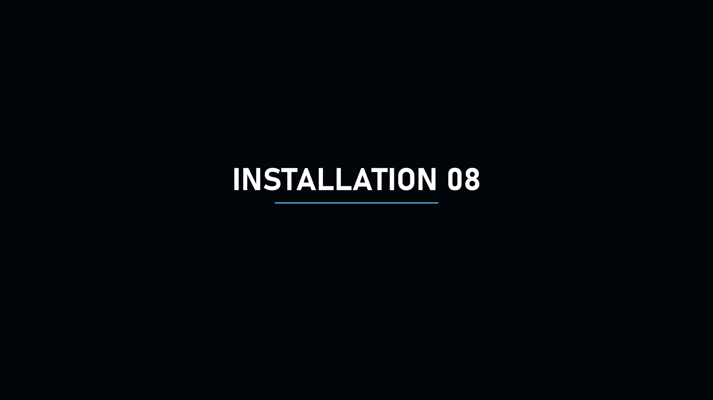
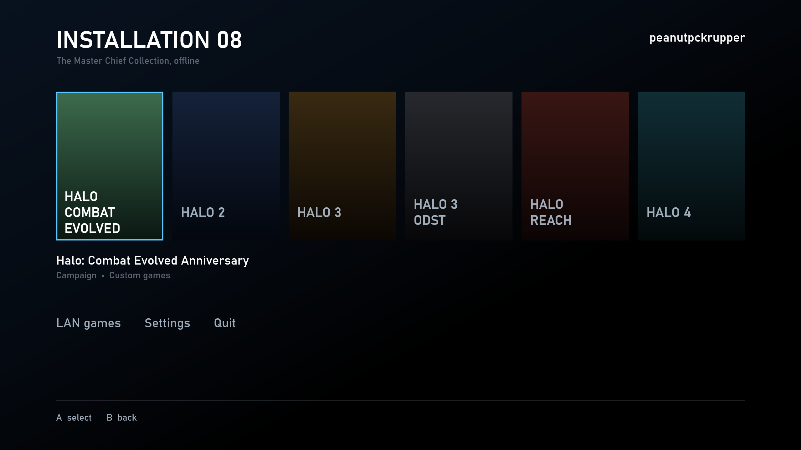

# Installation 08

**Halo: The Master Chief Collection on your jailbroken PS5, offline.**

Installation 08 runs MCC's six Halo games on the PS5 through [prospero-win](https://github.com/mpereiraesaa/prospero-win). It doesn't use MCC's own launcher, Steam or Easy Anti-Cheat. You copy one package and your own MCC game files to the console over FTP. There's nothing to build and nothing to install on your PC except an FTP program.

Installation 08 includes no game files. You need your own copy of Halo: The Master Chief Collection on Steam.

<p align="center">
   
</p>

## Download

Get the latest from [Releases](../../releases):

|File|For|
|-|-|
|`Installation08-PS5.zip`|**The PS5 package**: everything except your game files|
|`Installation08-<version>.zip`|`installation08.exe` for a Windows PC, to play LAN games with a PS5 (or on the PC itself)|

## What you can play

|||
|-|-|
|**Campaign**|Halo CE, Halo 2, Halo 3, ODST, Reach and Halo 4. Continue from your last save, or pick any mission and difficulty. Anniversary or classic graphics in Halo CE and Halo 2|
|**Firefight**|Reach and ODST, with every game type MCC ships|
|**Spartan Ops**|All 50 Halo 4 missions|
|**Custom games**|Halo CE, Halo 2, Halo 3, Reach and Halo 4: every map, the stock and matchmaking game types, and your own|
|**Forge**|Halo 3, Reach and Halo 4. Your maps are saved and playable in custom games|
|**LAN**|Campaign co-op, Spartan Ops, Firefight, custom games and Forge with other PS5s and PCs on your network, from one lobby|
|**Your Spartan**|Armor, colors and service tag per game, and Halo 4 loadouts|
|**Settings**|MCC's own Controls, Video, Audio and Accessibility settings, and per-game button remapping for the DualSense and keyboard/mouse|
|**Split-screen**|Up to 4 players|

Everything is local or on your own network. There is no online play.

## Setup on the PS5

You need:

* a jailbroken PS5 with [prospero-win](https://github.com/mpereiraesaa/prospero-win) installed and working;
* an FTP server running on the console;
* [FileZilla](https://filezilla-project.org) on your PC;
* MCC installed through Steam on your PC.

Then:

1. Copy the `prospero-win` folder from `Installation08-PS5.zip` into `/data/` on the PS5, and `C:\\Windows\\System32\\ucrtbase.dll` from your PC next to `installation08.exe` on the PS5.
2. Copy your MCC game folders, and `mcc/binaries/win64`, into `/data/prospero-win/mcc/`.
3. Start prospero-win and choose Installation 08. The first time, it asks for your player name.

[README-PS5.txt](ps5/README-PS5.txt) walks through every click, including updating and what to do if something goes wrong.

## LAN games: PS5 and PC together

PS5s and PCs running Installation 08 play together on the same network. To add a PC:

1. On the PC, copy `installation08.exe` (from `Installation08-<version>.zip`) into your MCC folder, next to `halo1`, `halo2`, `halo3` … For Steam that's usually `C:\\Program Files (x86)\\Steam\\steamapps\\common\\Halo The Master Chief Collection`. Then run it.
2. **To host:** on any machine, go to **LAN games** on the main menu and pick **Host a game**. Choose the game, the mode (Campaign, Firefight, Spartan Ops, Custom game or Forge) and its options.
3. **To join:** on the other machines, go to **LAN games** and pick the host's game from the list, or use **Join by IP address**.
4. The lobby shows each player as Ready, or what they're missing. For example, campaign co-op needs that game's campaign installed on every machine. When everyone is ready, the host presses **Start**. After the game, everyone comes back to the lobby.

Good to know:

* **Versions:** every machine needs the same version of Installation 08.
* **Firewall:** LAN play uses UDP port 27080. On a PC, allow it through Windows' firewall on private networks when asked.
* **PS5 with a PC:** the `ucrtbase.dll` copied from Windows during PS5 setup keeps them in step. The PS5's Wine does some of the games' math very slightly differently from Windows, which is enough for a PS5 and a PC to drift out of sync in a co-op game.
* **Windows Defender** may be wary of a new, unsigned program that loads game files. If it flags the exe, add an exclusion. More in the [PC README](dist/README.txt).

## Known limits

* LAN co-op starts from the beginning of a mission. The games don't continue a network co-op game from a checkpoint.
* A game type's own options (starting weapons and so on) can't be edited yet. Any game type file you have can be played.
* In-game button prompts are the games' own (Xbox).
* Two controllers at once for split-screen is untested on the PS5. PS4 controllers can't be used in PS5 apps.

## Building

One C++ source file, built with MinGW-w64 (Linux or WSL: `sudo apt-get install g++-mingw-w64-x86-64`):

```sh
cd src
x86\_64-w64-mingw32-windres installation08.rc -O coff -o res.o
x86\_64-w64-mingw32-g++ -std=c++17 -Os -municode -static -s -Wall -Wno-unused-parameter \\
    -o installation08.exe installation08.cpp res.o \\
    -ld3d11 -ldxgi -lgdi32 -ld2d1 -ldwrite -ladvapi32 -lws2\_32 -lole32 -lwindowscodecs -luuid
```

Every push is also built by GitHub Actions, and the exe is attached to each run.

The PS5 package is made from a prospero-win recipe. See [MAKING-THE-PS5-PACKAGE.txt](ps5/MAKING-THE-PS5-PACKAGE.txt).

## Repository

|Folder|What's in it|
|-|-|
|`src/`|The launcher's source, version resource and MCC's armor item list|
|`ps5/`|The prospero-win recipe, the package script and the PS5 README|
|`dist/`|The README shipped with the PC download|

## Third-party components

The PS5 package contains these, unmodified:

* [Wine](https://gitlab.winehq.org/wine/wine) files from prospero-win's Wine build (LGPL 2.1 or later), and prospero-win's `wowprospero.dll` (LGPL 2.1 or later). Their source: [prospero-win](https://github.com/mpereiraesaa/prospero-win).
* [DXVK](https://github.com/doitsujin/dxvk) 2.6.2 (zlib licence).

## Disclaimer

Installation 08 is a fan project. It is not affiliated with or endorsed by Microsoft, Xbox Game Studios or Halo Studios. Halo and The Master Chief Collection are trademarks of Microsoft. It includes no game files and does not connect to any online service.

